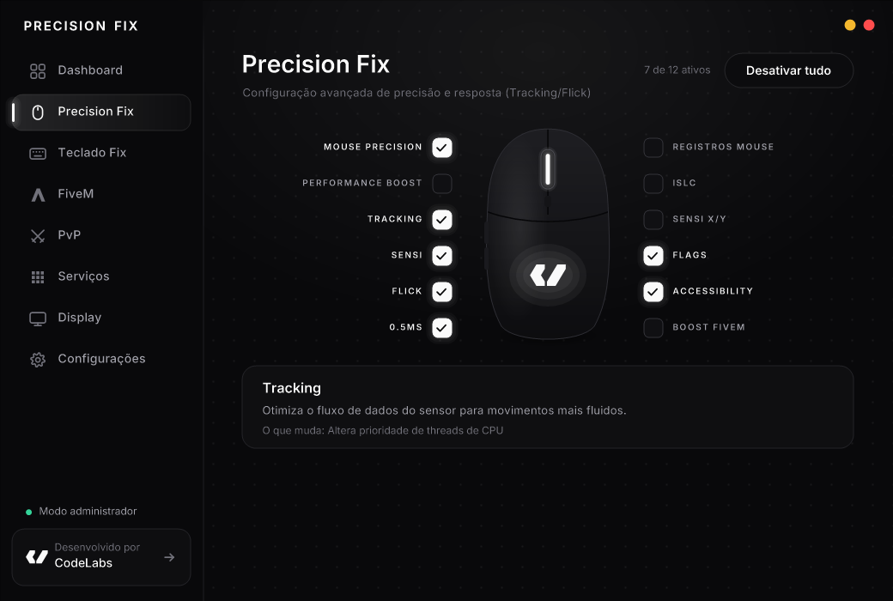
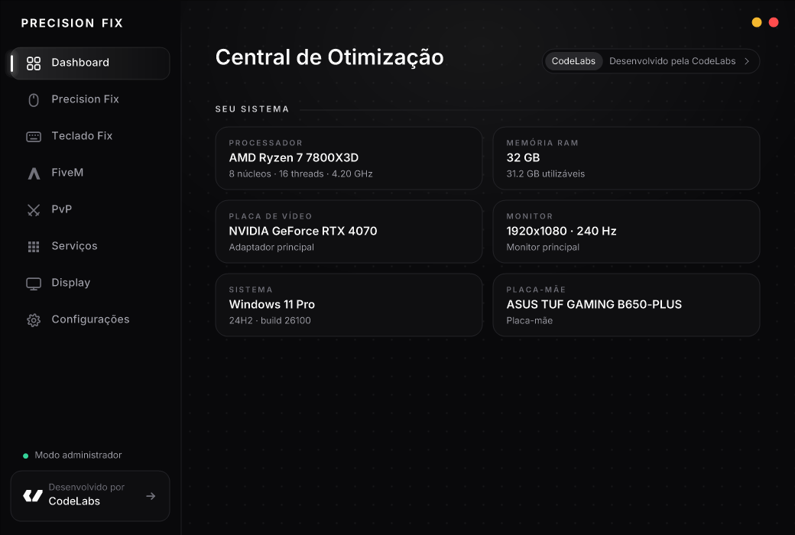
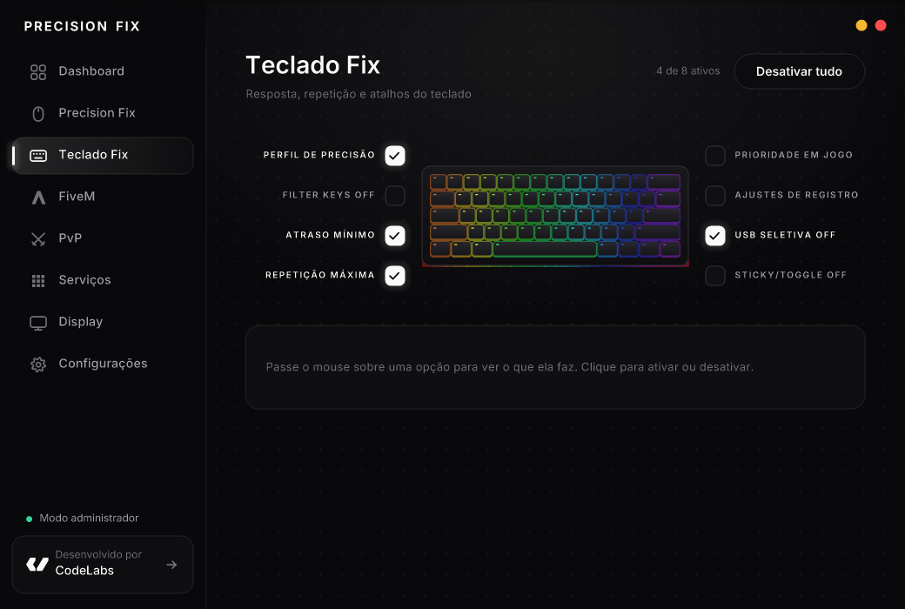
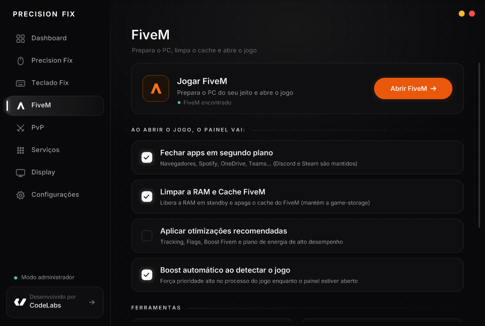
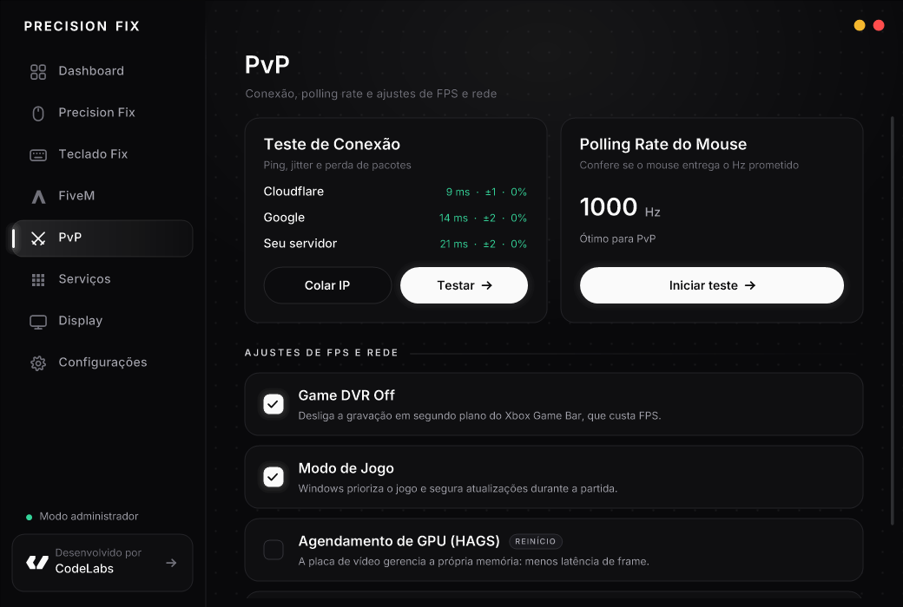
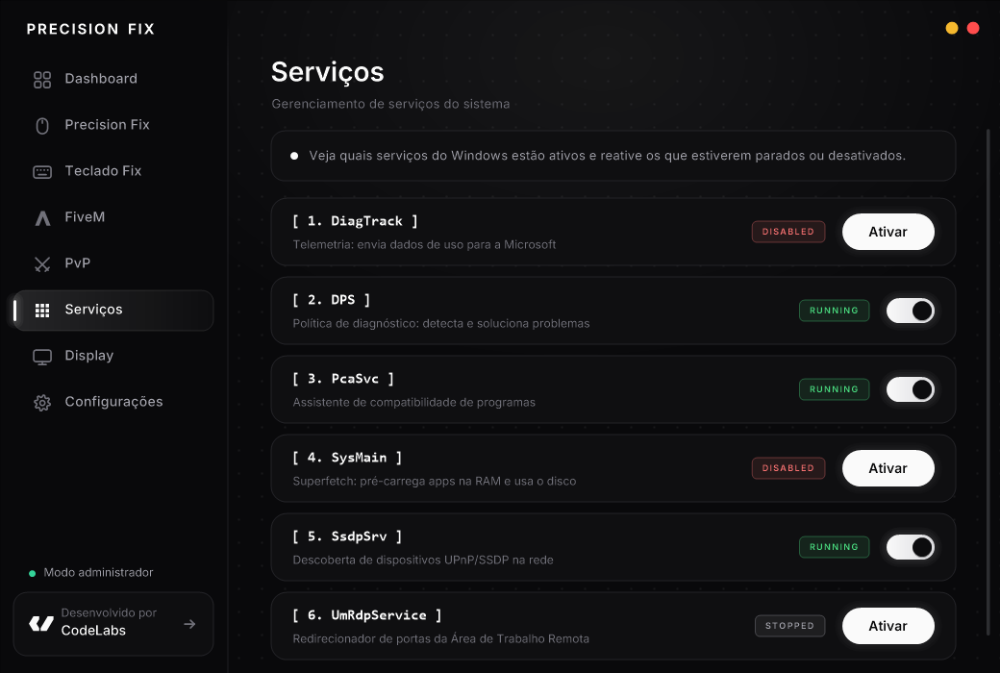
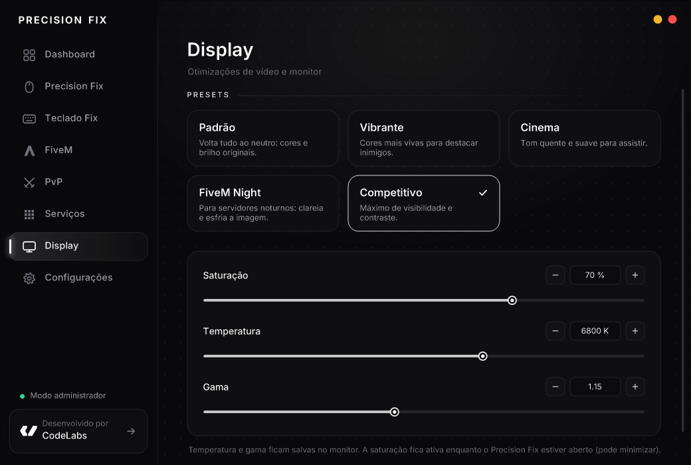

<div align="center">

# PRECISION FIX

**Otimizador de entrada e latência para Windows, feito para quem joga FiveM.**

Mouse 1:1, teclado sem atraso, timer de 0.5 ms, prioridade para o jogo, teste de conexão e limpeza do FiveM, tudo em um painel leve.

[](https://github.com/orenandev/PrecisionFix/releases/latest/download/PrecisionFix.exe)
[](https://github.com/orenandev/PrecisionFix/releases)
[](https://github.com/orenandev/PrecisionFix/actions)




### [⬇ Baixar a última versão](https://github.com/orenandev/PrecisionFix/releases/latest/download/PrecisionFix.exe)

</div>

---

## Como usar

1. Baixe o **[PrecisionFix.exe](https://github.com/orenandev/PrecisionFix/releases/latest/download/PrecisionFix.exe)**.
2. Abra o arquivo e aceite o pedido de administrador (necessário para alterar o registro e os serviços).
3. Marque as opções que quiser.
4. **Reinicie o PC.** Várias otimizações (timer 0.5 ms, registros do mouse/teclado, HAGS, QoS, Sensi) só passam a valer depois de reiniciar. O próprio app avisa quando houver reinício pendente.

> Não precisa instalar nada. O app **se atualiza sozinho**: sempre que sai uma versão nova aqui no GitHub, ele baixa e reinicia na versão mais recente.

> [!IMPORTANT]
> Tudo pode ser desfeito. Desmarque a opção ou use **Configurações → Reverter tudo** para voltar aos padrões do Windows.

---

## O que tem dentro

### Precision Fix (mouse)
| Opção | O que faz |
|---|---|
| Mouse Precision | Desliga "Aumentar precisão do ponteiro" (aceleração do Windows) |
| Performance Boost | Ativa o plano de energia de Alto Desempenho |
| Tracking | Ajusta a prioridade de threads da CPU (`Win32PrioritySeparation`) |
| Sensi | Aplica a curva MarkC 1:1 no registro |
| Flick | Tempo de hover mínimo e desativa a suspensão seletiva de USB |
| 0.5ms | Ajusta os timers do kernel via `bcdedit` |
| Registros Mouse | Reduz a fila do mouse (`MouseDataQueueSize`) |
| Islc | Impede a paginação de drivers e limpa a RAM em standby |
| Sensi X/Y | Velocidade do ponteiro 6/11 (multiplicador 1.0), sem aceleração |
| Flags | Prioridade de GPU e de agendamento para jogos (MMCSS) |
| Accessibility | Bloqueia os atalhos de StickyKeys e afins |
| Boost FiveM | Prioridade alta de CPU e I/O para GTA V / FiveM |

### Teclado Fix
Perfil de precisão (`KeyboardDataQueueSize`), Filter Keys off, atraso de repetição mínimo, taxa de repetição máxima, prioridade em jogo (`SystemResponsiveness`), prioridade do driver de teclado, suspensão USB off e Sticky/Toggle Keys off.

### FiveM
- **Abrir FiveM** já preparando o PC: fecha apps em segundo plano (Discord e Steam ficam), limpa RAM e cache e aplica as otimizações recomendadas.
- **Boost automático:** prioridade alta no processo do jogo enquanto o painel estiver aberto.
- **Limpar cache do FiveM:** apaga tudo em `data` **menos a `game-storage`** (você não precisa baixar o jogo de novo).
- Limpar logs e crashes, cache de DNS, arquivos temporários, fechar o FiveM travado e abrir a pasta do FiveM.

### PvP
- **Teste de conexão:** ping, jitter e perda até Cloudflare, Google e **o seu servidor** (copie o `IP:porta` e clique em *Colar IP*).
- **Polling rate do mouse:** mede quantos Hz o mouse entrega de verdade.
- **Ajustes de FPS e rede:** Game DVR off, Modo de Jogo, agendamento de GPU (HAGS) e prioridade de pacotes (QoS DSCP 46) para o FiveM.

### Serviços e Display
- **Serviços:** mostra quais serviços do Windows estão ativos e permite reativá-los.
- **Display:** presets (Padrão, Vibrante, Cinema, FiveM Night, Competitivo) e ajuste fino de saturação, temperatura de cor e gama.

<div align="center">
 
 
 
</div>

---

## Segurança

- **Código aberto:** tudo que o app faz está em [`src/`](src). As alterações são em registro, `bcdedit`, `powercfg`, serviços e configurações do Windows. O app não lê nem altera a memória do jogo.
- **Compilado pelo GitHub:** cada `.exe` das [Releases](https://github.com/orenandev/PrecisionFix/releases) é gerado automaticamente pelo GitHub Actions a partir deste código, e o **SHA256** vai publicado nas notas da versão.
- **Antivírus:** por pedir administrador e mexer em configurações do sistema, alguns antivírus com detecção por "machine learning" (ex.: `ML.Attribute.HighConfidence`) podem dar **falso positivo**. São detecções heurísticas, não assinaturas de vírus. Se tiver dúvida, confira o código ou compile você mesmo.

---

## Compilar você mesmo

**Visual Studio (MSVC):** abra o *x64 Native Tools Command Prompt* e rode:
```bat
build_msvc.bat 1.0.0
```

**MinGW-w64 (MSYS2 / WinLibs):**
```bash
./build.sh 1.0.0
```

O resultado é o `PrecisionFix.exe` na raiz do projeto.

### Releases automáticas
Cada push na `main` dispara o workflow [`release.yml`](.github/workflows/release.yml), que compila e publica a versão `v1.0.<número do build>`. Os apps já instalados se atualizam sozinhos ao abrir. Commits que mexem só em `README`/`docs` não geram versão nova.

---

<div align="center">

**Desenvolvido por [CodeLabs](https://usecodelabs.com/)**: bots, aplicações e sistemas sob medida.

<sub>Fonte Inter © The Inter Project Authors, licenciada sob a SIL Open Font License 1.1 (<a href="res/fonts/OFL.txt">OFL.txt</a>).<br>
Use por sua conta e risco. O Precision Fix não é afiliado ao FiveM, Cfx.re, Rockstar Games ou Microsoft.</sub>

</div>
